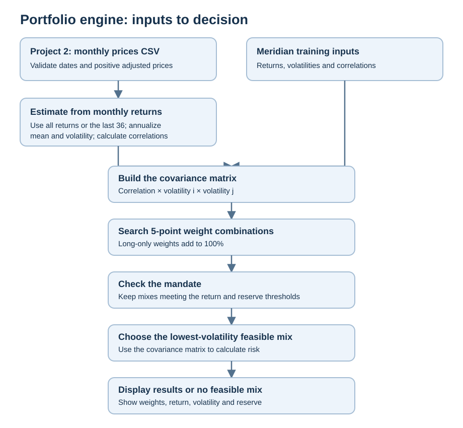
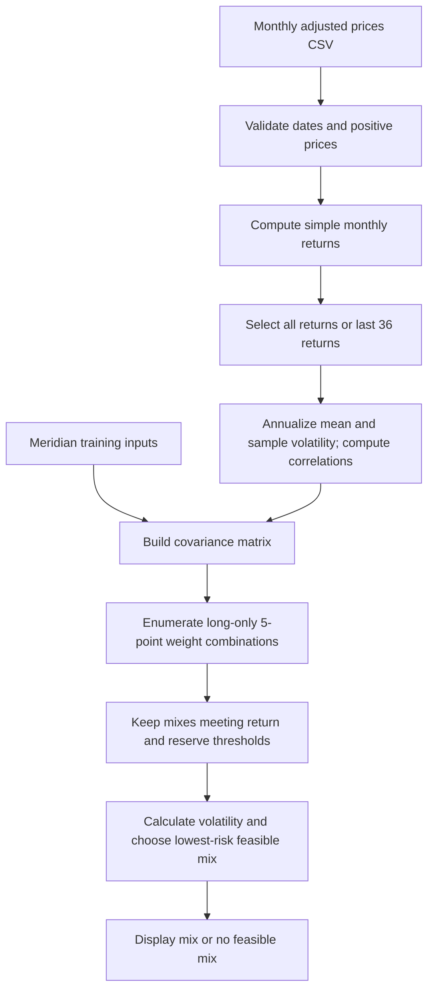

# Lab 15 — Portfolio Stability Decision

## D — Decision question

Which mix carries the least risk while meeting the mandate — and does the answer survive a one-point change in one estimate?

## R — Inputs and mandate

| Input | Meridian training case | Project 2 working universe |
|---|---|---|
| Assets | Treasury bills, Treasury 10-year note, investment-grade bond fund, global equity index fund | SGOV, SCHR, USIG, ACWI (roles below) |
| Returns, volatilities, correlations | Lab 14's course-authored assumptions in `portfolio.py` | To be estimated from monthly adjusted closes in `prices.csv`; historical estimates, not forecasts |
| Expected-return objective | 6.5% | At least 6.0% annual expected return |
| Hard constraint | At least 3% in reserve-eligible bills and 10-year Treasury note | At least 10% in SGOV |

The Project 2 selection covers the four roles in the [Project 2 mandate](Project%202%20-%20Investment%20Mandate.md). Its target and constraint are classroom choices, created for this project rather than drawn from the Meridian case.

| Ticker | Fund | Working role | Monthly adjusted-price source | Download date |
|---|---|---|---|---|
| SGOV | iShares 0–3 Month Treasury Bond ETF | Cash and reserve proxy | [Yahoo Finance](https://finance.yahoo.com/quote/SGOV/history/) | 2026-10-22 |
| SCHR | Schwab Intermediate-Term U.S. Treasury ETF | Government bonds | [Yahoo Finance](https://finance.yahoo.com/quote/SCHR/history/) | 2026-10-22 |
| USIG | iShares Broad USD Investment Grade Corporate Bond ETF | Investment-grade fixed income | [Yahoo Finance](https://finance.yahoo.com/quote/USIG/history/) | 2026-10-22 |
| ACWI | iShares MSCI ACWI ETF | Broad global equity | [Yahoo Finance](https://finance.yahoo.com/quote/ACWI/history/) | 2026-10-22 |

`prices.csv` contains 60 consecutive monthly observations, October 2021 through September 2026, with date first and oldest month first. The date labels the first of each month; the value is the source's monthly adjusted close, not a price observed on the first. Sixty prices yield 59 monthly returns. Adjusted closes incorporate distributions and splits and may be revised by Yahoo.

## Lab 14 engine rerun

`python portfolio.py` reproduced the known answers: benchmark 6.80% return and 10.46% volatility; equal weight 5.20% and 5.21%; inverse volatility 3.77% and 1.05%. The three reserve weights were 0.0%, 50.0%, and 90.3%, respectively.

## Engine and app

Run `python -m streamlit run app.py`. For Meridian, leave the objective at 6.5% and reserve at 3%. For the Project 2 case, upload `prices.csv`, set the objective to 6.0% and the minimum reserve to 10%, and ensure only SGOV is checked as reserve-eligible. The app compares the current inputs to the data as loaded, holding the chosen objective, reserve minimum, and eligibility selections fixed.

The final 36-month option uses 36 return observations, requiring 37 monthly prices. The complete file supplies 59 monthly returns from 60 prices. Estimates use arithmetic mean monthly returns times 12, sample standard deviation times the square root of 12, and correlations of the same monthly returns. Historical estimates are not forecasts.

## Verification: Meridian

| Input | Bills / 10-year / IG / equity | Expected return | Volatility |
|---|---|---:|---:|
| As loaded | 0 / 20 / 25 / 55 | 6.51% | 9.44% |
| Equity expected return reduced from 8.0% to 7.0% | 0 / 10 / 10 / 80 | 6.53% | 12.94% |
| IG–equity correlation changed from 0.25 to 0.50 in both cells | 0 / 40 / 0 / 60 | 6.52% | 9.73% |

The first two mixes differ by a maximum of 25 percentage points in equity. The Streamlit test exercised the default and edited equity-return controls, producing the first two results and the 25-point change. For the correlation check, both entries in `portfolio.py` were temporarily changed to 0.50 and the Meridian app was rerun with Streamlit's test runner. It showed the third result above; the original file was restored byte-for-byte afterward. The test was automated rather than a refresh in the student's browser.

## Project 2 results

For the 6.0% objective and 10% minimum SGOV reserve, applying the same search to the downloaded data gives:

| Window | SGOV / SCHR / USIG / ACWI | Estimated return | Estimated volatility | Reserve |
|---|---|---:|---:|---:|
| All 59 monthly returns | 70 / 0 / 0 / 30 | 6.02% | 4.56% | 70% |
| Last 36 monthly returns | 90 / 0 / 0 / 10 | 6.05% | 1.19% | 90% |

The largest weight change is **20 percentage points**: SGOV rises from 70% to 90% and ACWI falls from 30% to 10%. The period switch changes all estimated returns, volatilities, and correlations, so it does not isolate the effect of a one-point change. The 5-point grid gives the lowest-risk feasible mix among the combinations tested, not necessarily the continuous optimum.

The student reported that the Meridian app check worked and provided an app screenshot showing the all-month and last-36-month results above. The two visible allocations differ by 20 percentage points at most.

## Estimation risk and decision draft

Estimation risk is the risk that estimated inputs differ from the returns, volatilities, and relationships that materialize. An optimizer can amplify a small error because it selects the particular weights that look best under the supplied estimates; a small change can move the feasible boundary and make a very different combination appear optimal. In this case changing the historical window moved the largest weight by 20 points, although that test changes several estimates together.

**Reflection:** Estimation risk is the chance that the returns, volatility, and correlations used in the app turn out to be wrong. Switching from all available monthly returns to the last 36 moved SGOV from 70% to 90% and ACWI from 30% to 10%, a largest change of 20 percentage points; the switch changed several estimates at once, so I cannot attribute the move to one estimate alone. Before adopting the mix, I would check return assumptions, test additional scenarios, and confirm that the 10% reserve fits my needs.

**My call:** Pilot the mix rather than adopt it yet. The allocation changed by 20 percentage points when I switched historical windows, and a one-point reduction in ACWI's expected return moved five points from SGOV to ACWI. I would consider adopting it after checking the return assumptions, testing additional scenarios, and confirming that the 10% reserve fits my needs.

## Partner attack

My partner reduced the all-month ACWI expected-return estimate from about 11.25% to 10.25%: the mix moved from 70% SGOV and 30% ACWI to 65% SGOV and 35% ACWI, while estimated volatility rose from 4.56% to 5.29%. The five-point shift toward equity shows that a lower equity-return estimate requires more equity to meet the 6.0% target, so I would check the estimate and its sensitivity before relying on the mix.

Explain the reflection to a partner and complete the Brightspace quiz; these are not represented as completed here.

## In-person work

Partner explanation: My universe contains SGOV for a short-term Treasury-bill reserve, SCHR for government bonds, USIG for investment-grade corporate bonds, and ACWI for global stocks. My objective is the lowest estimated-volatility mix with at least a 6.0% estimated annual return. My hard constraint is at least 10% in SGOV. The portfolio is long-only and its weights add to 100%. The estimates from monthly prices describe history and are not guaranteed forecasts.

I drew the engine on paper. My explanation of `search_portfolio`:

1. The function receives the assets and their estimates, correlations, return objective, reserve-eligible assets, and minimum reserve weight.
2. It checks that the reserve minimum is between 0% and 100% and that at least one asset is present.
3. It calls `covariance_matrix` to turn correlations and volatilities into the inputs needed to calculate portfolio risk.
4. `best = None` means no qualifying portfolio has been found yet.
5. The inner `compositions` function divides 20 units among the assets. Each unit is 5%, so each combination is long-only and sums to 100%.
6. For each combination, the code converts units into weights and calculates expected return and reserve weight.
7. If a mix falls below the return objective or reserve minimum, `continue` skips it.
8. For each qualifying mix, it calls `portfolio_volatility` using the weights and covariance matrix.
9. If the mix is the first qualifying one or has lower volatility than the current best, the code saves its weights, return, volatility, and reserve weight.
10. After checking every combination, it returns the best mix. If none qualify, `best` is still `None`, so the app reports no qualifying mix.

**Partner question:** How does the search function know which portfolio to choose?

**My answer:** It tries every long-only combination in 5-percentage-point steps. It skips any mix that falls below the return objective or reserve minimum. For the mixes that remain, it calculates volatility and keeps the one with the lowest value. If none qualify, it returns no mix.

The student reported swapping roles with the partner. The partner attack is recorded above; the reflection remains to be discussed.
